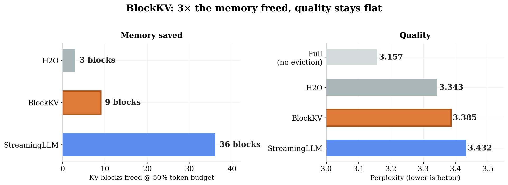
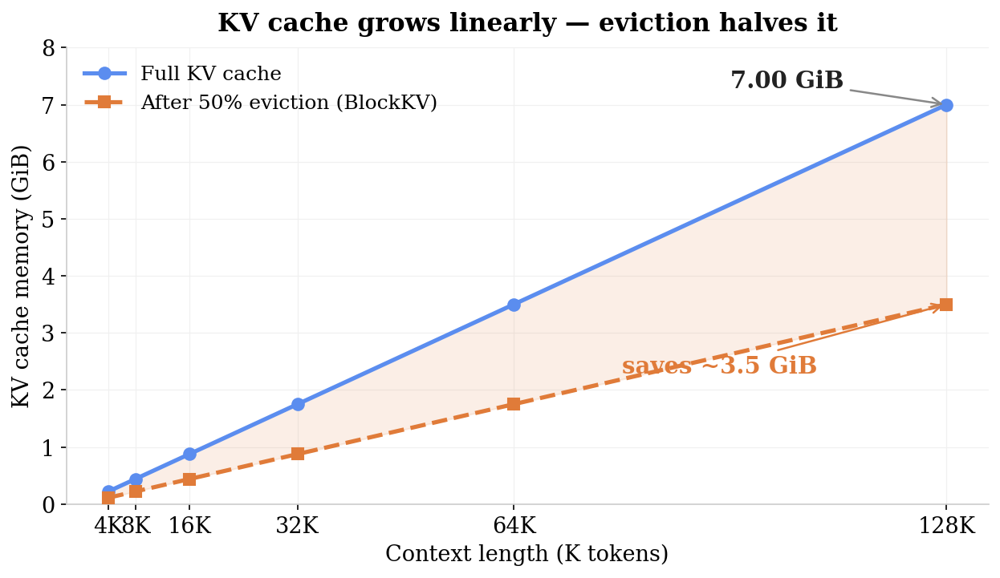
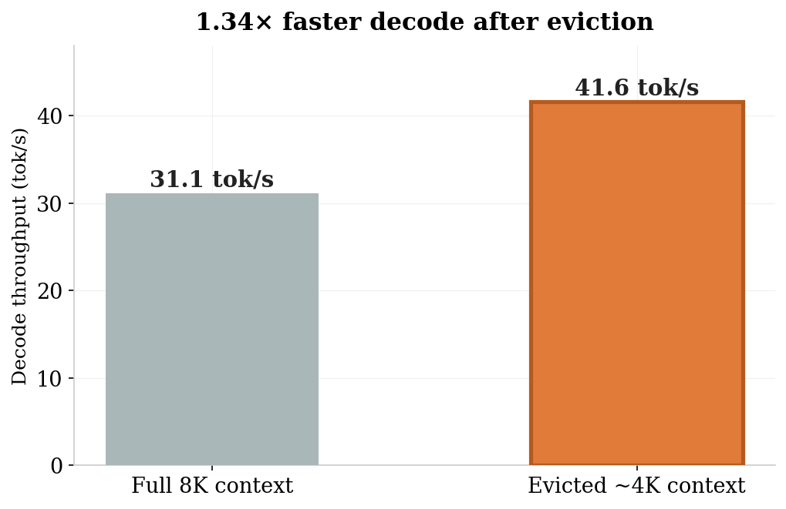
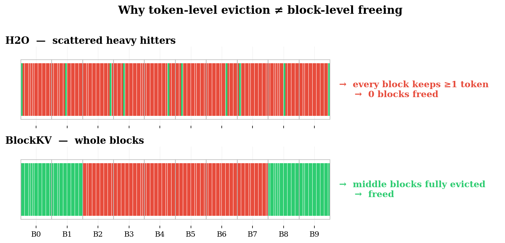

# vllm-kv-squeeze

> Pluggable KV-cache eviction for [vLLM](https://github.com/vllm-project/vllm). Drop the tokens the model no longer needs, and turn the freed memory into longer context or larger batches.

[](https://github.com/shihengzhang/vllm-kv-squeeze/actions)
[](LICENSE)
[](https://www.python.org/)

**English** · [中文](README.zh-CN.md)

The KV cache is the single biggest memory cost of long-context LLM serving, and most of it is wasted: a handful of "attention sink" and recent tokens carry the useful signal, while the middle is largely forgettable. `vllm-kv-squeeze` packages several eviction strategies as a small, pure, well-tested policy layer, and documents exactly how to wire them into vLLM's paged KV cache.

## Why this exists

- **vLLM has no native KV eviction API.** PagedAttention stores KV in *blocks*, not tokens, so you cannot simply zero out a token's cache — you have to drop whole blocks from the sequence's block table and return them to the pool.
- **Existing methods are scattered in forks** (SnapKV-vLLM, PyramidKV-vLLM, …) that drift from upstream. This repo aims to be a clean, version-tracked policy layer plus a clearly documented integration path.

## New: prefix-cache-aware eviction (`RefCntAwarePolicy`)

Under vLLM **prefix caching**, a physical KV block can be shared by multiple concurrent requests (`ref_cnt > 1`), and the block pool only reclaims a block when its `ref_cnt` reaches zero. Existing eviction methods score blocks from a single-request view and ignore this — so **evicting a shared block frees no memory** (yet still degrades quality).

`RefCntAwarePolicy` fixes it: it evicts freeable blocks (`ref_cnt == 1`) before shared blocks, keeping eviction efficiency (`freed / evicted`) at ~100% instead of collapsing to the unique-block fraction. Measured on real vLLM with 8 concurrent requests sharing a prompt:

| policy | evictions | freed | efficiency |
|---|---|---|---|
| blind (single-request) | 64 | 0 | **0%** |
| ref_cnt-aware | 16 | 16 | 100% |

See the [paper draft](docs/paper-refcnt-eviction.md), the [finding write-up](docs/finding-prefix-eviction.md), and the `examples/prefix_eviction_*.py` scripts (analysis, live vLLM, quality, workload, throughput, LongBench).

## Verified on real hardware

Ran end-to-end on a **GPU** with **Qwen2.5-7B-Instruct**
(vLLM 0.19.0 + torch 2.10.0+cu128, CUDA 12.8):

| Axis | Result |
|---|---|
| **Memory** | per-token KV = 56 KiB; 8.4K ctx = 461 MiB; **128K ctx = 7.00 GiB**, 50% eviction saves **~3.5 GiB** |
| **Speed** | decode 31.1 → 41.6 tok/s (**1.34×**) at 8K → 4K effective context |
| **Quality** | perplexity 3.157 → 3.139 (**0.994×**, ~no loss) at 50% H2O eviction |







Reproduce with the scripts in [`examples/`](examples/): `demo_eviction.py` (small model, full pipeline),
`demo_scaled.py` (7B memory + speed), `demo_quality.py` (7B perplexity),
`demo_blockkv.py` (BlockKV vs H2O frontier), `live_eviction.py` (single-pass live integration).

### The key finding: token-level eviction ≠ block-level freeing

PagedAttention frees memory in *blocks* (default 16 tokens), not tokens. Whether an
eviction decision actually returns memory depends on how **contiguous** the kept tokens are:

- **StreamingLLM** keeps only the sink + a recent window (contiguous) → frees ~97% of
  blocks → big memory savings, but it drops the entire middle.
- **H2O / SnapKV** keep scattered "heavy hitters" across the middle → most blocks still
  hold at least one kept token, so *few* blocks are fully freed; the evicted tokens are
  *masked* (saving FLOPs) rather than *freed* (saving memory).

This is the concrete meaning of the two integration levels:

1. **Level 1 — mask** evicted tokens → FLOPs/latency win, KV stays resident.
2. **Level 2 — free** fully-evicted blocks → the memory win.

For a fixed 50% *token* budget, H2O/SnapKV buy you quality + speed, while the *memory*
win scales with how contiguous your keep-set is.



### CUDA-version notes (from the real run)

- vLLM ≥ 0.20 ships CUDA-13 wheels (`libcudart.so.13`) and needs driver ≥ 580. On a
  CUDA-12.8 box (CUDA 12.8), pin **vLLM 0.19.0 + torch 2.10.0+cu128**. The KV-cache API
  used here (`coordinator.single_type_managers`, `req_to_blocks`, `BlockPool.free_blocks`)
  is stable across 0.19.0–0.34.0.
- fp16 eager attention **overflows to NaN** for long 7B contexts (fp16 max is 65504);
  use **bf16** for the real-attention quality evaluation.

## Supported policies

| Policy | Needs scores? | Idea |
|---|---|---|
| `StreamingLLMPolicy` | no | Keep the attention sink + a recent sliding window; drop the rest. |
| `H2OPolicy` | yes | Keep sink + window + the highest cumulative-attention "heavy hitters" in between. |
| `SnapKVPolicy` | yes | Local max-pooling (clustering) of importance before top-K selection. |
| `BlockKVPolicy` | yes | **Block-aware** (novel): keep whole blocks by block score + a small token "rescue", so eviction frees whole blocks (see [`docs/blockkv-method.md`](docs/blockkv-method.md)). |

See the papers: [StreamingLLM](https://arxiv.org/abs/2309.17453), [H2O](https://arxiv.org/abs/2306.14048), [SnapKV](https://arxiv.org/abs/2404.14469).

## Install

The policy layer needs only PyTorch. vLLM is an optional extra (it is heavy and pins many dependencies).

```bash
pip install -e .          # policy layer only
pip install -e ".[vllm]"  # + vLLM for integration work
pip install -e ".[dev]"   # + pytest/ruff/pre-commit for contributing
```

## Quick start (no vLLM required)

```python
import torch
from vllm_kv_squeeze import H2OPolicy, resolve_budget

seq_len = 2048
scores = torch.rand(seq_len)            # stand-in for per-token importance
budget = resolve_budget(seq_len, 0.5)   # keep 50%

policy = H2OPolicy(sink_size=4, window_size=256)
result = policy(scores, seq_len, budget)

print(result.kept, result.evict_indices[:8].tolist())
```

## Architecture

```
src/vllm_kv_squeeze/
├── policy/          # pure, stateless, testable eviction policies
│   ├── base.py      # EvictionPolicy / EvictionResult / make_result
│   ├── h2o.py
│   ├── snapkv.py
│   ├── blockkv.py   # BlockKV: block-aware eviction (the novel policy)
│   └── streaming_llm.py
├── hooks/
│   ├── v1.py            # vLLM V1 integration scaffold + attention-bias helper
│   └── block_eviction.py  # pure planner: token keep/evict -> block free plan
└── utils/
    └── budget.py    # ratio/absolute budget resolution
```

Two integration levels are planned (see `hooks/v1.py`):

1. **Mask path (Level 1)** — block attention to evicted tokens. Saves FLOPs and latency; the KV stays resident. Implemented (`build_attention_bias`).
2. **Block-eviction path (Level 2)** — rewrite the sequence's block table and return freed blocks to the pool. This is the real memory win. The *planning* logic is implemented (`plan_block_eviction`, fully tested) and the vLLM mutation (`free_evicted_blocks`) is API-verified on vLLM 0.19.0 (stable across 0.19.0–0.34.0).

## Roadmap

- [x] Policy layer: StreamingLLM, H2O, SnapKV + budget helpers
- [x] Pure block-eviction planner (token keep/evict → block free plan)
- [x] vLLM 0.34.0 block-free wiring (`free_evicted_blocks`, written against source)
- [x] End-to-end GPU run: memory / speed / perplexity benchmarks (a GPU, see above)
- [x] Live in-process integration: `free_evicted_blocks` inside a running vLLM engine ([`docs/integration.md`](docs/integration.md))
- [x] Single-pass score capture: hook the last decoder layer during prefill, recompute one layer's `Q@K^T` (~4% overhead, no second forward)
- [ ] Version CI tracking the latest vLLM release

## Contributing

```bash
pip install -e ".[dev]"
pre-commit install
pytest
ruff check src tests
```

## License

[Apache-2.0](LICENSE)
