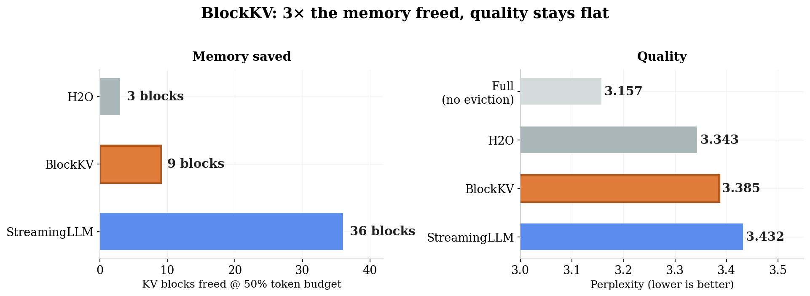
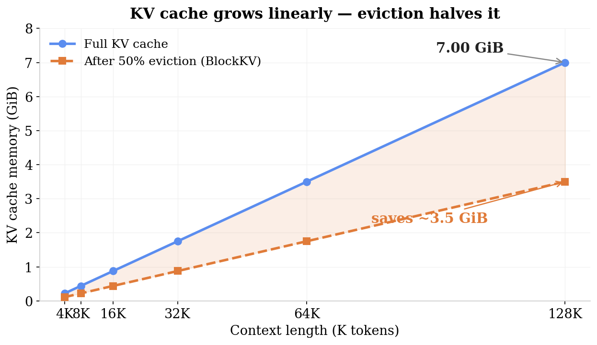
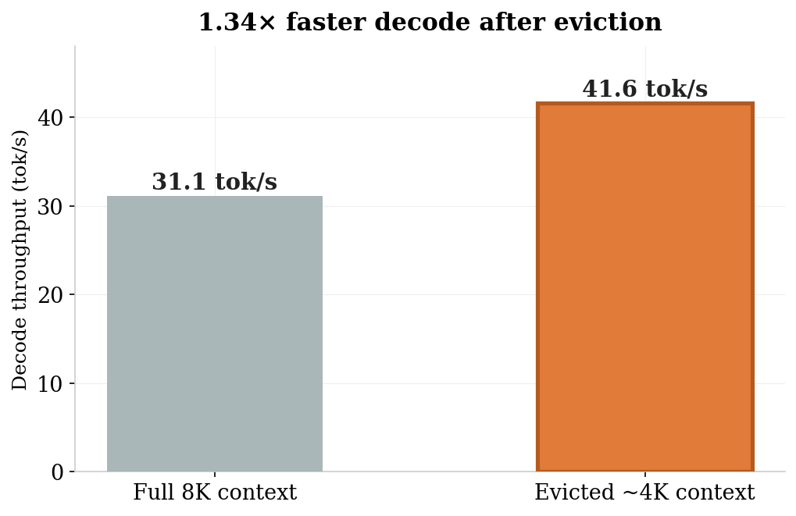
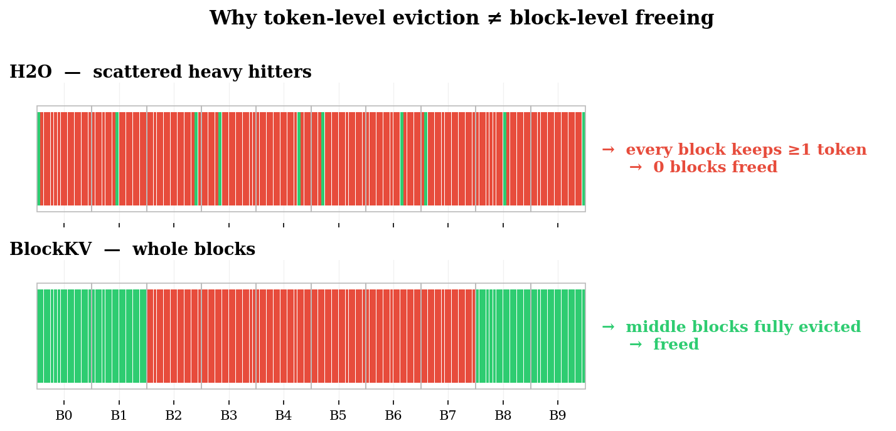

# vllm-kv-squeeze

> 可插拔的 [vLLM](https://github.com/vllm-project/vllm) KV 缓存淘汰。丢掉模型不再需要的 token，把省下的显存换成更长的上下文或更大的并发。

[](https://github.com/shihengzhang/vllm-kv-squeeze/actions)
[](LICENSE)
[](https://www.python.org/)

[English](README.md) · **中文**

KV 缓存是长上下文 LLM 推理最大的显存开销，而其中大部分是被浪费的：只有少数「注意力汇点」和最近的 token 承载了有效信号，中间的大部分其实可以忘掉。`vllm-kv-squeeze` 把几种淘汰策略封装成一个干净、纯函数、经过测试的策略层，并给出接入 vLLM 分页 KV 缓存的完整路径。

## 为什么做这个

- **vLLM 没有原生的 KV 淘汰 API。** PagedAttention 把 KV 存成 *块*（block）而不是 token，所以你没法单独清零某个 token 的缓存——必须从序列的块表里整块丢弃、归还给块池。
- **现有方法散落在各种 fork 里**（SnapKV-vLLM、PyramidKV-vLLM…），与上游脱节。本仓库的目标是做一个干净、版本可追踪的策略层 + 清晰的接入路径。

## 真机验证

在 **GPU** 上用 **Qwen2.5-7B-Instruct** 端到端实测
（vLLM 0.19.0 + torch 2.10.0+cu128，驱动 570 / CUDA 12.8）：

| 维度 | 结果 |
|---|---|
| **内存** | 每 token KV = 56 KiB；8.4K 上下文 = 461 MiB；**128K 上下文 = 7.00 GiB**，50% 淘汰省 **~3.5 GiB** |
| **速度** | decode 31.1 → 41.6 tok/s（**1.34×**）@ 8K → 4K 有效上下文 |
| **质量** | perplexity 3.157 → 3.139（**0.994×**，几乎无损）@ 50% H2O 淘汰 |







用 [`examples/`](examples/) 里的脚本复现：`demo_eviction.py`（小模型完整链路）、
`demo_scaled.py`（7B 内存+速度）、`demo_quality.py`（7B perplexity）、
`demo_blockkv.py`（BlockKV vs H2O 前沿）、`live_eviction.py`（单阶段 live 集成）。

### 核心发现：token 级淘汰 ≠ 块级释放

PagedAttention 按 *块*（默认 16 个 token）释放内存，而不是按 token。淘汰决策能否真正省内存，取决于保留 token 有多**连续**：

- **StreamingLLM** 只留 sink + 最近窗口（连续）→ 释放 ~97% 的块 → 省内存多，但中间全丢。
- **H2O / SnapKV** 保留散落在中间的「heavy hitter」→ 几乎每个块都还沾着至少一个保留 token，所以**整块释放的很少**；被淘汰的 token 是被 *掩码*（省算力），而不是被 *释放*（省显存）。

这正是两层集成的具体含义：

1. **Level 1 — 掩码**被淘汰 token → 省 FLOPs/延迟，KV 仍驻留。
2. **Level 2 — 释放**整块被淘汰的块 → 才是真正的省内存。

在固定 50% *token* 预算下，H2O/SnapKV 换来的是质量+速度，而**内存**收益取决于保留集的连续程度。



### CUDA 版本注意（来自实测）

- vLLM ≥ 0.20 发布的是 CUDA-13 wheel（`libcudart.so.13`），需要驱动 ≥ 580。在 CUDA-12.8（驱动 570）的机器上，要锁定 **vLLM 0.19.0 + torch 2.10.0+cu128**。这里用到的 KV 缓存 API（`coordinator.single_type_managers`、`req_to_blocks`、`BlockPool.free_blocks`）在 0.19.0–0.34.0 之间稳定。
- fp16 的 eager 注意力在长 7B 上下文上会**溢出成 NaN**（fp16 上限 65504）；真实注意力的质量评测要用 **bf16**。

## 支持的策略

| 策略 | 需要分数? | 思路 |
|---|---|---|
| `StreamingLLMPolicy` | 否 | 保留注意力汇点 + 最近滑动窗口，其余丢弃。 |
| `H2OPolicy` | 是 | 保留汇点 + 窗口 + 中间累计注意力最高的「heavy hitter」。 |
| `SnapKVPolicy` | 是 | 对重要性做局部最大池化（聚类）后再 top-K 选取。 |
| `BlockKVPolicy` | 是 | **按块感知**（原创）：按块分数保留整块 + 少量 token「救援」，让淘汰能整块释放（见 [`docs/blockkv-method.md`](docs/blockkv-method.md)）。 |

参考论文：[StreamingLLM](https://arxiv.org/abs/2309.17453)、[H2O](https://arxiv.org/abs/2306.14048)、[SnapKV](https://arxiv.org/abs/2404.14469)。

## 安装

策略层只需要 PyTorch；vLLM 是可选依赖（很重、且锁定很多依赖）。

```bash
pip install -e .          # 仅策略层
pip install -e ".[vllm]"  # + vLLM，做集成
pip install -e ".[dev]"   # + pytest/ruff/pre-commit，做贡献
```

## 快速上手（无需 vLLM）

```python
import torch
from vllm_kv_squeeze import H2OPolicy, resolve_budget

seq_len = 2048
scores = torch.rand(seq_len)            # 每 token 重要性的占位
budget = resolve_budget(seq_len, 0.5)   # 保留 50%

policy = H2OPolicy(sink_size=4, window_size=256)
result = policy(scores, seq_len, budget)

print(result.kept, result.evict_indices[:8].tolist())
```

## 架构

```
src/vllm_kv_squeeze/
├── policy/          # 纯函数、无状态、可测试的淘汰策略
│   ├── base.py      # EvictionPolicy / EvictionResult / make_result
│   ├── h2o.py
│   ├── snapkv.py
│   ├── blockkv.py   # BlockKV：按块感知淘汰（原创策略）
│   └── streaming_llm.py
├── hooks/
│   ├── v1.py            # vLLM V1 集成脚手架 + 注意力偏置辅助
│   └── block_eviction.py  # 纯规划：token keep/evict → 块释放计划
└── utils/
    └── budget.py    # 比例/绝对预算解析
```

两个集成层级（见 `hooks/v1.py`）：

1. **掩码路径（Level 1）**——屏蔽对已淘汰 token 的注意力。省 FLOPs 和延迟，KV 仍驻留。已实现（`build_attention_bias`）。
2. **块释放路径（Level 2）**——改写序列块表、把释放的块归还块池。这才是真正的省内存。规划逻辑已实现（`plan_block_eviction`，全测试覆盖），vLLM 侧 mutation（`free_evicted_blocks`）已在 vLLM 0.19.0 上 API 验证（0.19.0–0.34.0 稳定）。

## 路线图

- [x] 策略层：StreamingLLM、H2O、SnapKV + 预算辅助
- [x] 纯块释放规划器（token keep/evict → 块释放计划）
- [x] vLLM 0.34.0 块释放接线（`free_evicted_blocks`）
- [x] 端到端 GPU 跑分：内存 / 速度 / perplexity（GPU）
- [x] 进程内 live 集成：在运行中的 vLLM 引擎里调 `free_evicted_blocks`（[`docs/integration.md`](docs/integration.md)）
- [x] 单阶段分数捕获：prefill 时 hook 最后一层，补算一层 `Q@K^T`（约 4% 开销，无需二次前向）
- [ ] 版本 CI 追踪最新 vLLM 版本

## 贡献

```bash
pip install -e ".[dev]"
pre-commit install
pytest
ruff check src tests
```

## 许可证

[Apache-2.0](LICENSE)
