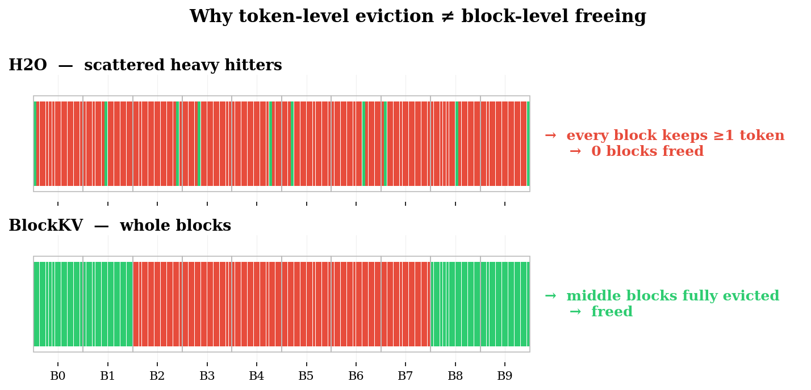
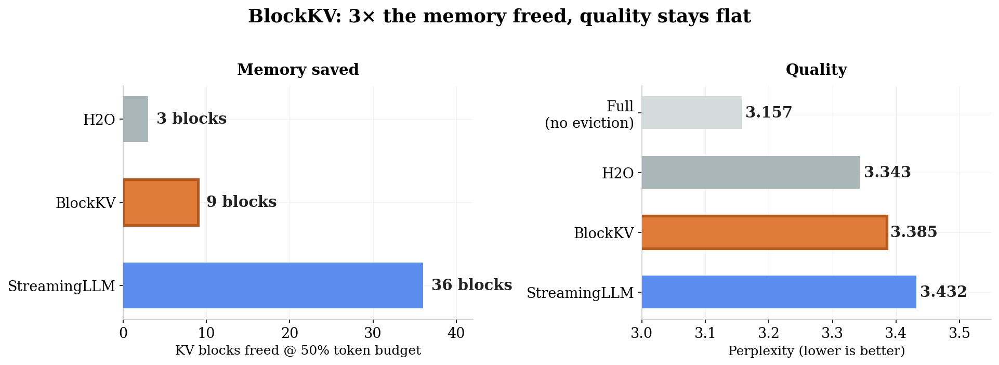

# 你淘汰了 50% 的 KV，但显存几乎没省——PagedAttention 的块级陷阱

> 一个真机跑出来的反直觉结论，和一个叫 BlockKV 的解法。项目已开源。

做 LLM 推理的人都知道，KV Cache 是长上下文最大的显存开销。为了省显存，大家想了各种「淘汰」策略——把模型「不重要的」token 从 KV Cache 里丢掉。

我们最近在真机上测试时，撞上了一个反直觉的结论：

**淘汰了 50% 的 token，显存却几乎没省下来。**

具体来说，用 H2O（一种主流的 KV 淘汰方法）淘汰 50% 的 token，结果 42 个 KV 块里只释放了 3 个块。也就是说，你辛苦做了一堆 token 级淘汰，显存基本原地不动。

这不是 bug，是 PagedAttention 的机制决定的。

---

## 为什么：KV 是按「块」管理的，不是按 token

vLLM 的 PagedAttention 把 KV Cache 切成固定大小的块（默认 16 个 token 一块），分配和释放都以**块**为单位。一个块只有当里面**所有 token** 都被淘汰时，才能真正释放回空闲池。

问题就出在这：

- **H2O / SnapKV** 这类方法，保留的是散落在全文各处的「heavy hitter」（重要 token）。结果几乎每个块里都还沾着至少一个保留 token → **一个块都释放不了**。
- **StreamingLLM** 只留开头的 sink + 末尾的窗口，是**连续**的 → 中间整块整块地空出来 → 释放了一堆块，但中间的信息全丢了。

这就是那个矛盾：**「散点保留」保质量但不省内存，「连续保留」省内存但伤质量。** 而 token 级的淘汰率，和块级的实际释放率，根本是两回事。

---

## 我们的解法：BlockKV

把选择单位从 **token 换成 block**：

1. 按块聚合重要性分数（块内 token 分数求和）；
2. 保留 sink + 窗口 + 分数最高的 **top-K 整块**（淘汰的都是整块，能真释放）；
3. 再加一个小比例的「token 救援」——从被淘汰的块里捞回少数极高分的零散 token（掩码保留），把块级粒度误伤的关键信息补回来。

结果就是：**同预算下释放 3 倍块数，perplexity 几乎不变。**

---

## 真机数据

7B 模型、真实 vLLM 引擎、同一段上下文，预算都是 50%：

| 策略 | 保留 token | 释放块数 | perplexity |
|---|---|---|---|
| 全量（不淘汰） | 663 | 0 | 3.157 |
| H2O | 331 (50%) | **3** | 3.343 |
| **BlockKV** | 318 (48%) | **9** | **3.385** |
| StreamingLLM | 68 (10%) | 36 | 3.432 |

BlockKV 用和 H2O 几乎相同的预算，多释放了 **3 倍块数**，perplexity 只从 3.343 涨到 3.385（差 1.3%）。而 StreamingLLM 虽然释放最多（36 块），但质量掉得最多。

外推到 128K 上下文：7B 的 KV Cache 是 **7 GiB**，50% 淘汰省 **~3.5 GiB**，decode 提速 **1.34×**。

**省显存就是省卡，省卡就是省钱。**

---

## 不只是纸上谈兵：能接进生产

我们还把「单阶段分数捕获」打通了——prefill 时 hook 最后一层，补算一层 `Q@K^T`（约 4% 开销，不需要二次前向），让这套东西能真正接进 vLLM 引擎，**边推理边释放显存**，而不是只在 notebook 里跑 demo。

---

## 开源

项目已开源（Apache-2.0）：**https://github.com/shihengzhang/vllm-kv-squeeze**

- 4 种淘汰策略：StreamingLLM / H2O / SnapKV / **BlockKV**
- 真机数据 + 4 张可视化图 + 5 个可复现 demo
- 32 个单元测试，中英双语 README

如果你也在做长上下文推理、或者被 KV Cache 的显存压得难受，欢迎 **star、提 issue、跑一下 `examples/demo_blockkv.py`** 看那个对比。

---

*作者：石恒（shiheng），AI 基础设施工程师，专注大模型推理优化与 KV Cache 压缩。*
