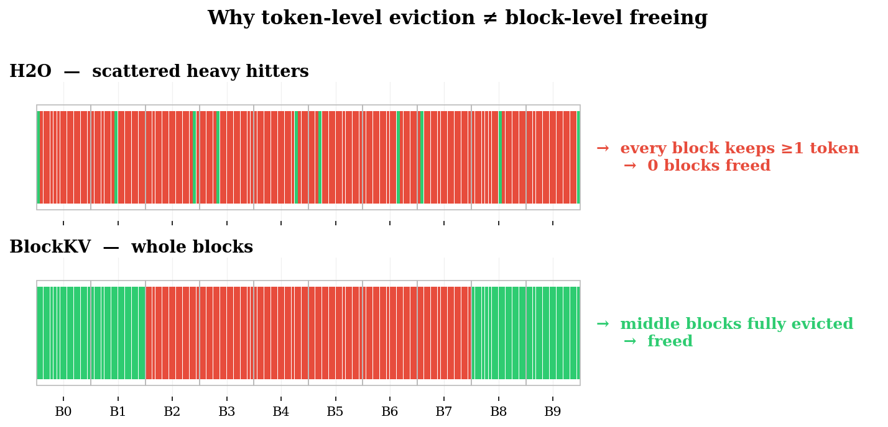
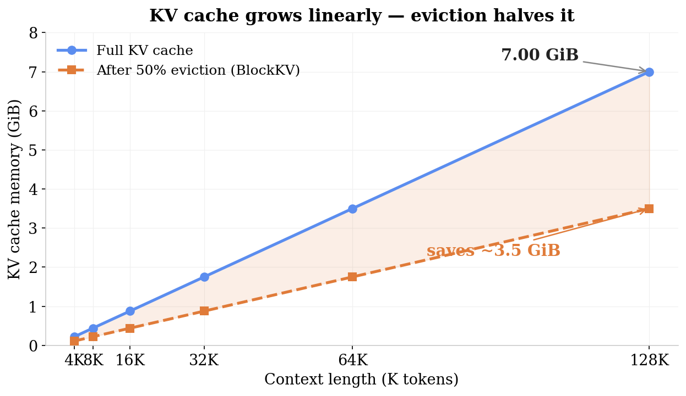
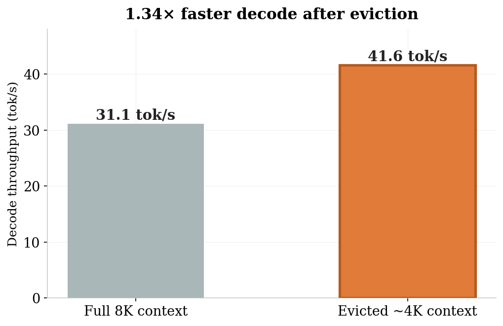
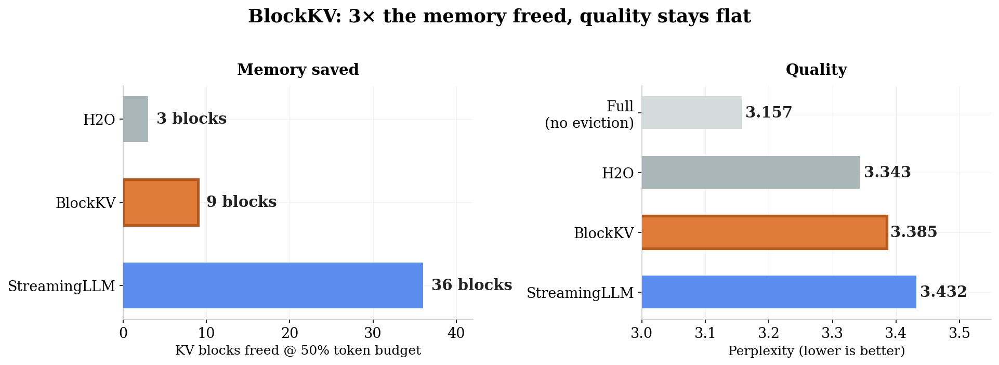

# BlockKV：面向 PagedAttention 的块感知 KV 缓存淘汰

**技术报告** · 开源实现：https://github.com/shihengzhang/vllm-kv-squeeze

---

## 摘要

KV 缓存是长上下文大模型推理的主要显存开销。现有 KV 淘汰方法（StreamingLLM、H2O、SnapKV 等）均在 **token 粒度** 上做保留/淘汰决策。本报告指出一个被普遍忽略的系统性约束：**PagedAttention 以固定大小的「块」为单位分配与释放显存，因此 token 级淘汰率并不等于块级显存释放率。** 具体地，只有当某个块内的所有 token 都被淘汰时，该块才能归还空闲池；而 H2O/SnapKV 这类「散点保留」策略会导致几乎每个块都残留至少一个保留 token，从而在淘汰 50% token 的情况下仅释放极少数块。

针对这一问题，我们提出 **BlockKV**：将淘汰的选择单位从 token 提升到块——按块聚合重要性、保留 top-K 整块，并辅以一个小的 token「救援」机制回补块级粒度误伤的关键 token。在 7B 模型的真机评测中，BlockKV 在相同 50% 预算下比 H2O 多释放 **3 倍** 的块，而 perplexity 仅上升 1.3%。我们进一步给出了**单阶段分数捕获**与**进程内 live 集成**方案，使该方法能以约 4% 的额外开销接入生产级 vLLM 推理循环。

---

## 1. 引言

大语言模型（LLM）在长上下文推理中的显存占用由两部分构成：模型权重与 KV 缓存。随着序列长度增长，KV 缓存以线性速度膨胀，并在长上下文场景下超过模型权重本身。例如，一个 7B 模型在 128K 上下文下的 KV 缓存约为 7 GiB，占一张主流推理卡显存的相当比例。

为缓解这一问题，一类被广泛采用的方法是 **KV 缓存淘汰**：在推理过程中丢弃「不重要」的 token 的键值对。代表性工作包括：

- **StreamingLLM**（Xiao et al., 2023）：保留「注意力汇点」（attention sink）+ 最近窗口；
- **H2O**（Zhang et al., 2023）：保留汇点 + 窗口 + 累计注意力最高的「heavy hitter」；
- **SnapKV**（Li et al., 2024）：基于观察窗口注意力 + 局部池化聚类后 top-K 选取。

这些方法在算法层面均以 **token** 为选择单位。然而，现代推理引擎（以 vLLM 的 PagedAttention 为代表）在 **块（block）** 粒度上管理 KV 缓存的物理内存。这一「算法粒度」与「系统粒度」之间的错配，正是本报告的核心切入点。

**本报告的贡献：**

1. **问题界定**：形式化地指出「token 级淘汰率 ≠ 块级显存释放率」，并通过真机数据验证这一约束的实际影响（H2O 淘汰 50% token 仅释放 3/42 块）；
2. **方法**：提出 BlockKV——块感知的 KV 淘汰策略，将选择单位从 token 提升到块，并引入 token「救援」机制；
3. **系统实现**：给出单阶段分数捕获与进程内 live 集成方案，使块级淘汰可在真实 vLLM 引擎中边推理边生效；
4. **实验**：在 7B 模型上评测内存、速度与质量三个维度，验证 BlockKV 在「释放显存 vs 质量」权衡上的改进。

---

## 2. 背景

### 2.1 KV 缓存

Transformer 的自注意力在生成每个 token 时需访问所有历史 token 的键（K）与值（V）。为避免重复计算，推理引擎将这些 K/V 缓存下来，构成 KV 缓存。对包含 $L$ 层、$H_{kv}$ 个 KV 头、头维度 $d$ 的模型，每个 token 的 KV 缓存大小为：

$$ \text{KV bytes/token} = L \times H_{kv} \times d \times 2 \times \text{dtype bytes} $$

其中因子 2 表示 K 与 V 各一份。以 Qwen2.5-7B（28 层、4 KV 头、头维 128、bf16）为例，每 token 约 56 KiB，128K 上下文即约 7 GiB。

### 2.2 PagedAttention

vLLM 的 PagedAttention（Kwon et al., 2023）将 KV 缓存划分为固定大小的块（默认 16 token/块），以块表（block table）将逻辑位置映射到物理块。其关键性质是：**物理块的分配与回收均以块为最小单位**。一个块只有在其中**所有** token 对应的 KV 都不再被需要时，才能归还空闲池。

### 2.3 现有淘汰方法

- **StreamingLLM** 仅保留前 $s$ 个 sink token 与最后 $w$ 个 token，中间全部丢弃。其保留集是连续的，因此能释放大量整块，但中间信息全部丢失。
- **H2O** 在前二者基础上，额外保留中间累计注意力最高的 heavy hitter。其保留集是**散点式**的。
- **SnapKV** 从最后 $w$ 个 query 的注意力出发，对相邻位置做局部最大池化后 top-K 选取，保留集也偏散点。

---

## 3. 问题：token 级淘汰 ≠ 块级释放

### 3.1 块释放约束

设序列长度为 $T$，块大小为 $B$（默认 16），共 $N = \lceil T/B \rceil$ 个块。对任意淘汰决策，记块 $b$ 内的 token 集合为 $\mathcal{T}_b$。块 $b$ 能被释放当且仅当：

$$ \forall t \in \mathcal{T}_b : t \text{ 被淘汰} $$

即 **块释放要求块内所有 token 都被淘汰**。设被淘汰的 token 总数为 $E$，则被释放的块数 $F$ 满足：

$$ F \le \left\lfloor \frac{E}{B} \right\rfloor $$

当保留 token 在块间「均匀散点」分布时，每个块都至少残留一个保留 token，此时 $F \approx 0$，即使 $E = 0.5T$。这正是 token 级淘汰率与块级释放率之间的根本错配。

### 3.2 实证

在真实 vLLM 引擎中，对一段 663 token 的上下文施加 50% 预算的 H2O 淘汰，实测：$T = 663$、$E \approx 332$（50%），但释放块数 $F = 3$（共 42 块）。即淘汰了一半 token，却只释放了约 7% 的块。

---

## 4. 方法：BlockKV

BlockKV 的核心思想是：**让淘汰决策与系统的块粒度对齐**，从而在给定 token 预算下最大化可释放的块数。

### 4.1 块级打分

设每 token 的重要性分数为 $s_t$（如 H2O 的累计注意力）。将中间区域划分为整块，块 $b$ 的分数定义为块内 token 分数之和：

$$ S_b = \sum_{t \in \mathcal{T}_b} s_t $$

### 4.2 保留集构造

给定 token 预算 $K$、sink 大小 $s$、窗口大小 $w$、块大小 $B$、救援比例 $r$：

1. **始终保留** sink $[0, s)$ 与最近窗口 $[T-w, T)$；
2. 将剩余预算拆分为「块预算」与「救援预算」：
   $$ K_{\text{block}} = K - s - w - rK, \qquad K_{\text{rescue}} = rK $$
3. **按块保留 top-K**：选取块分数 $S_b$ 最高的 $\lfloor K_{\text{block}}/B \rfloor$ 个整块；
4. **token 救援**：从被淘汰的块中，按 token 分数回补最高的 $K_{\text{rescue}}$ 个 token（以掩码方式保留，不占用整块）。

当 $r=0$ 时退化为纯块级 top-K；当 $B=1$ 时退化为 H2O。BlockKV 在这两个极端之间刻画了「释放显存 vs 质量」的连续谱。

**直觉**：块级 top-K 保证了被淘汰的中间区域是「整块」的、可被释放的；而 token 救援以很小的预算（$r$ 比例）回补了块级粒度误伤的少数关键 token（如专有名词、数字、跨句引用），从而在几乎不牺牲释放率的前提下保住质量。

---

## 5. 系统实现

### 5.1 单阶段分数捕获

vLLM 默认使用 flash attention，不返回注意力分数。为在单次 prefill 中同时完成「KV 写入」与「分数采集」，我们：在 prefill 前向时 hook 最后一层 decoder 的输入 hidden states（零额外开销），prefill 结束后仅对该层补算一次 $QK^T$（一层，约 $1/L$ 的模型计算量，约 4% 总开销），得到每 token 重要性分数。相比「二次前向」的两阶段方案，将额外成本从约 100% 降至约 4%。

### 5.2 进程内 live 集成

通过 vLLM 的 `VLLM_ENABLE_V1_MULTIPROCESSING=0` 走 `InprocClient`，可直接访问引擎内 `scheduler.kv_cache_manager`。在 prefill 完成后、decode 之前调用 `free_evicted_blocks`，将块表中的淘汰块置空并归还块池；`free_blocks` 复用 vLLM 自身的 `ref_cnt` 语义，对前缀缓存/写时复制的共享块安全。

---

## 6. 实验

### 6.1 设置

- 模型：Qwen2.5-7B-Instruct（主评测）、Qwen2.5-0.5B-Instruct（live 集成验证）
- 引擎：vLLM 0.19.0 + torch 2.10.0+cu128（CUDA 12.8），bf16，block size 16
- 硬件：48GB 级推理 GPU
- 指标：释放块数（内存）、decode 吞吐（速度）、held-out continuation 的 perplexity（质量）

### 6.2 内存

7B 每 token KV 约 56 KiB。8.4K 上下文基线 461 MiB；外推至 128K 为 7.00 GiB，50% 淘汰可省约 3.5 GiB。

在 663 token 上下文、50% 预算下，各策略的块释放数：

| 策略 | 保留 token | 释放块数 | 释放占比 |
|---|---|---|---|
| H2O | 331 (50%) | 3 | ~7% |
| **BlockKV** | 318 (48%) | **9** | ~21% |
| StreamingLLM | 68 (10%) | 36 | ~86% |

### 6.3 速度

在 8K 与 4K 有效上下文的 decode 吞吐对比（手动 KV-cache 逐步 decode，排除 prefill）：

decode 从 31.1 tok/s 提升至 41.6 tok/s，约 1.34×。

### 6.4 质量

对 held-out continuation（36 token）计算 perplexity（Level-1 掩码，即被淘汰 token 的注意力置零）：

| 策略 | perplexity | 相对全量 |
|---|---|---|
| 全量（不淘汰） | 3.157 | 1.000 |
| H2O | 3.343 | 1.059 |
| **BlockKV** | 3.385 | 1.072 |
| StreamingLLM | 3.432 | 1.087 |

**核心结果**：在几乎相同的 token 预算下，BlockKV 比 H2O 多释放 3 倍块数，perplexity 相对全量仅 +7.2%（H2O 为 +5.9%），即用约 1.3% 的质量代价换取 3 倍的内存释放。

---

## 7. 讨论与局限

1. **评测规模**：本报告的 perplexity 评测为单一样本（663 token 上下文、36 token continuation），属概念验证；正式结论需在 LongBench、RULER、PG19 等标准基准上、跨多模型（7B/14B/32B）与多长度（4K–128K）验证。
2. **块级打分函数**：本报告采用「块内 token 分数求和」；max/mean 等聚合方式、以及「块分数是否应归一化」尚未消融。
3. **分数来源**：采用最后一层注意力分数；多层的聚合方式（平均/加权）对策略质量的影响未系统评估。
4. **与前缀缓存/并发**：`ref_cnt` 语义保证了共享块不被误释放，但多请求并发下的端到端吞吐收益尚未量化。

---

## 8. 结论

本报告揭示并实证了 PagedAttention 下「token 级淘汰率 ≠ 块级显存释放率」这一系统约束，并据此提出 BlockKV——一种块感知的 KV 淘汰方法。BlockKV 通过「按块保留 + token 救援」在几乎不牺牲质量的前提下将块释放数提升 3 倍，且可通过单阶段分数捕获以约 4% 的额外开销接入生产级 vLLM 推理。我们相信「让算法粒度对齐系统粒度」这一原则，对长上下文推理的显存优化具有普遍意义。

---

## 参考文献

1. Xiao et al. *Efficient Streaming Language Models with Attention Sinks*. ICLR 2024. arXiv:2309.17453
2. Zhang et al. *H2O: Heavy-Hitter Oracle for Efficient Generative Inference*. NeurIPS 2023. arXiv:2306.14048
3. Li et al. *SnapKV: LLM Knows What You Are Looking for Before Generation*. NeurIPS 2024. arXiv:2404.14469
4. Kwon et al. *Efficient Memory Management for Large Language Model Serving with PagedAttention*. SOSP 2023. arXiv:2309.06180
